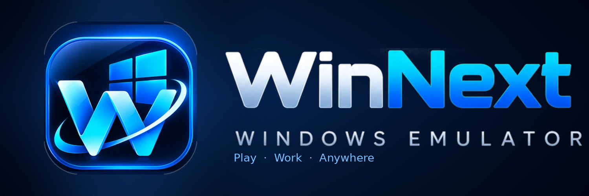

<!-- Language: فارسی -->

  

# 🪟 WinNext — اجرای برنامه‌ها و بازی‌های ویندوز در اندروید

**WinNext** یک محیط دسکتاپ الهام‌گرفته از Windows 11 برای اندروید است که برنامه‌های سازگار ویندوز را از طریق یک موتور سازگاری واقعی (Wine/Proton) اجرا می‌کند.

طراحی و توسعه: **کاظم رفیعی** — افغانستان، ولایت غزنی، ولسوالی جاغوری
Designed and developed by **Kazem Rafiei**

سایر زبان‌ها: [دری (README.md)](README.md) · [English (README.en.md)](README.en.md)

---

## ⚙️ موتور اجرا (وضعیت واقعی)

WinNext از پروژهٔ متن‌باز Winlator Bionic مشتق شده و یک **موتور اجرای واقعی** دارد:

| جزء | نقش |
|---|---|
| **Proton 9.0 (Wine)** | لایهٔ سازگاری ویندوز (در زمان ساخت دانلود می‌شود) |
| **Box64 / FEXCore** | ترجمهٔ x86/x86_64 → ARM |
| **DXVK / VKD3D / Vegas** | DirectX → Vulkan |
| **Turnip / Zink / VirGL** | درایورهای گرافیکی |

**محدودیت‌های واقعی (صادقانه):**
- اجرای هر برنامهٔ ویندوزی تضمین نمی‌شود؛ سازگاری به CPU (arm64)، GPU، نسخهٔ اندروید و خود برنامه بستگی دارد.
- Microsoft Office نسخهٔ دسکتاپ ممکن است اجرا نشود یا ناپایدار باشد؛ جایگزین رسمی: نسخه‌های اندرویدی یا وب Microsoft 365.
- ظاهر Windows 11 به معنای ویندوز واقعی مایکروسافت نیست؛ WinNext محصول رسمی مایکروسافت نیست.

## 🚀 شروع سریع — بدون تنظیمات فنی

1. برنامه را باز کنید؛ دسکتاپ WinNext نمایش داده می‌شود.
2. در نخستین اجرا، **کانتینر پیش‌فرض "WinNext Default"** خودکار ساخته می‌شود.
3. آیکون آبی **«برنامه‌های WinNext»** را لمس کنید — محیط ویندوزی واقعی مستقیماً آغاز می‌شود.
4. از Start Menu محیط، برنامه‌های نصب‌شده را اجرا کنید.

- کانتینر پیش‌فرض عمومی است؛ فایل‌ها و برنامه‌های نصب‌شده پس از خروج و راه‌اندازی مجدد حفظ می‌شوند.
- آیکون آبی و دکمهٔ Play از یک سرویس اجرای مشترک استفاده می‌کنند؛ لمس مکرر نشست تکراری نمی‌سازد.
- تنظیمات پیشرفته (Wine، درایور گرافیکی، DX Wrapper) برای کاربران حرفه‌ای باقی مانده است.

## 🖥️ دسکتاپ و شخصی‌سازی

- صفحهٔ **Personalization**: والپیپر از تصاویر داخلی یا گالری، تم روشن/تاریک دسکتاپ، رنگ تأکیدی رابط
- والپیپرها به محیط واقعی ویندوزی اعمال می‌شوند و پس از خروج باقی می‌مانند.
- File Manager با مرور حافظهٔ اندروید و درایو C محیط

## 📦 نصب برنامه‌های ویندوز

- فایل‌های `.exe` و `.msi` را داخل محیط اجرا نصب کنید؛ هرگز مستقیماً به اندروید سپرده نمی‌شوند.
- میان‌برها در Start Menu واقعی محیط ثبت می‌شوند.

## 🌍 زبان‌ها

- پیش‌فرض: **دری افغانستان (fa-AF)** با رابط راست‌به‌چپ
- فارسی، پشتو، انگلیسی، آلمانی، آلمانی سوئیسی، فرانسوی، ایتالیایی
- تغییر از **تنظیمات → زبان برنامه**؛ انتخاب حفظ می‌شود.

## 🔒 قفل برنامه (اختیاری)

- رمز PIN (۴ تا ۸ رقم) با هش امن (SHA-256 + نمک) ذخیره می‌شود؛ تلاش‌های مکرر محدود می‌شوند.
- مستقل از حساب ویندوزی محیط است و با تغییر آن داده‌ها از بین نمی‌رود.

## 🛠️ رفع خطاهای رایج

| مشکل | راه حل |
|---|---|
| «موتور نصب نشده است» | «آغاز نصب» را بزنید و دسترسی فایل‌ها را بدهید. |
| خطا در ساخت محیط | فضای خالی را بررسی و دوباره تلاش کنید. |
| محیط خراب | تعمیر خودکار با پشتیبان‌گیری؛ در صورت عدم بازیابی پیام واضح نمایش داده می‌شود. |

## 📲 نیازمندی‌ها

اندروید ۸.۰+ (arm64-v8a)، Vulkan، پیشنهاد: ۴ گیگابایت RAM.

## 🐞 گزارش مشکل

در [Issues مخزن GitHub](https://github.com/kazemwafa2/WinNext/issues) گزارش دهید.

## 📄 مجوز و قدردانی

- بر پایهٔ [Winlator](https://github.com/brunodev85/winlator)، Winlator Bionic و Star-Compose.
- Wine/Proton (LGPL 2.1)، Box64 (MIT)، FEX-Emu (MIT)، Mesa/Turnip (MIT) — اعتبار سازندگان خارجی حفظ می‌شود.
- مجوز پروژه: [LICENSE](LICENSE) — والپیپرهای همراه آثار اصلی WinNext هستند.
